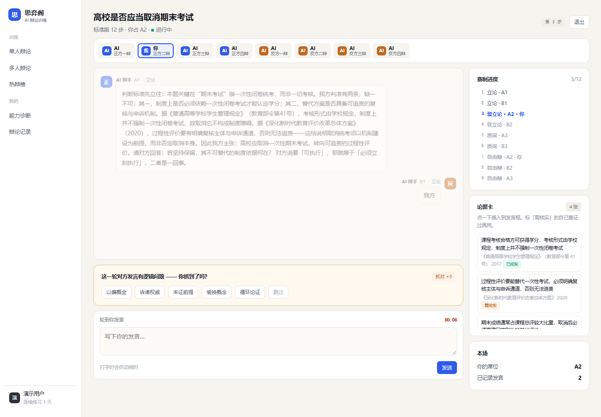

# Lyceum · 思弈阁

**一个以 AI 4v4 辩论训练为核心、带社区生态的辩论平台。**

核心是训练：8 个 AI 辩手各占一席、各有打法，你坐其中一个位置和整支队伍打完整场，
打完立刻拿到五维评分、逐回合点评和改写建议。核心之外还有围绕辩题的社区、短视频广场和多人房间——
让「练完之后有人可聊、有片可看、有人可对」。

**在线试用：<http://120.24.204.138:8787/siyige/>**



## 产品边界（先说清楚做什么、不做什么）

| 层 | 内容 | 投入 |
|---|---|---|
| **核心（优先投入）** | 单人/多人对辩、8 席 AI、18 步赛制、五维评分、复盘改写建议、能力雷达、评分有效性评测集 | 持续深化，不再加新功能 |
| **支撑** | 账号与钱包、AI 三档计费（含 BYOK）、语音输入 | 只做稳定与易用 |
| **生态（已做，维护为主）** | 社区（帖子/评论/举报）、短视频广场、好友私信、通知 | 冻结功能，只修 bug |
| **运营** | 管理台、参数配置、告警 | 维护为主 |

> 一句话：**训练这条线做深，生态这条线保持能用**。新增功能一律先问「它让训练更有效吗」，答不上就不做。

## 核心能力的两个新证据

**语音输入**（辩论是口语活动）：浏览器内实时转写、可说满 90 秒、转写文本可编辑再发送；
不支持时自动回退键盘。语音回合在复盘里单独标记，用来区分「口语表达差」和「论证差」。

**评分有效性评测集**：20 题 × 4 档 = 80 条人工分档作为基准，量化「系统评分与人判断的一致性」——
pairwise accuracy **1.000**（120/120）、合法率/完整率 **100%**、重复评分漂移 **0**。

另附第三方标注工具：[盲评表](docs/评测集-盲评表.xlsx)（80 条打乱顺序、隐藏档位，辩手 A/B 两个独立工作表）
+ `scripts/ingest_human_labels.py` 回收打分并算 Spearman —— 把客观性从「作者自评」升级到「辩手独立标注」只需两条命令。

详见 [评分有效性评测报告](docs/评分有效性评测报告.md)。这是回答「练了到底有没有用」的第一步。
## 现在能做什么

- **18 步赛制**（质询每方 2 轮、自由辩 4 轮随机生成）：立论 → 驳立论 → 质询 → 自由辩 → 总结
- **8 席 AI 辩手**：框架派 / 快攻派 / 例证派 / 归谬派 / 定义派 / 反例派 / 归因派 / 价值派
- **自由选位**：挑任意一席，其余 7 席 AI 补位
- **自拟辩题**：AI 先审可辩性，不合格给修改建议
- **自由辩抢拍**：8 秒窗口，抢到才有话筒
- **抓漏**：每轮埋一个逻辑漏洞，从 5 类里指认，答对 +3
- **作战卡**：赛前给定义、立论骨架、对方打法、回应句式
- **复盘**：五维评分（立论 25 / 论证 30 / 表达 15 / 应变 20 / 论据 10）+ 逐回合点评
- **论据卡**：48 张（12 辩题 × 4），标「需核实」，编数字倒扣
- **热辩榜 / 能力分析 / 辩论记录**：Redis ZSET 排行，五维雷达，只记录不排名
- **多人房间**：8 席，房间号拉人，缺位 AI 补
- **讨论社区**：闲聊 / 教程 / 求助三类帖子、两层楼中楼、点赞、浏览计数、敏感词自动打码
- **账号登录**：注册 / 登录 / 登出；发帖评论点赞需登录，浏览不用；未登录不计浏览数
- **登录后开打**：辩论、房间、战绩、诊断统一要登录；对局只有本人（或同房间的人）能看能操作
- **社区治理**：帖子 / 评论可举报，管理员在 `/admin` 后台处置（删内容 / 禁言 1·3·7 天 / 全站封禁），处置可撤销
- **账号安全**：用户与管理员均可改密码，改后旧登录立即失效；管理员处置留痕，可一键恢复被删内容
- **通知与 @**：评论 / 回复 / 点赞 / @ / 被删 / 被处罚都会提醒，点赞按内容聚合成一条；侧栏红点显示未读数
- **社区 @AI**：`@DeepSeek` 像普通用户一样回帖（带回帖层级和「AI」标签），每账号每天 5 次
- **好友与私聊**：搜人加好友（可附言）→ 双向确认；只有好友能私聊，消息走 WebSocket 实时到达，断线按 id 补拉、连不上自动降级 3 秒轮询
- **邀请组队**：房主在房间页点「邀请好友」，对方在聊天窗收到卡片，点一下直接进房
- **AI 档位三选**：基础版（本地 ollama，免费）/ 高级版（平台模型，按 token 计费 + 服务费）/ 自带 Key（全免费）；多人房整场由房主付费
- **能力分析**：六维雷达（立论 / 论证 / 表达 / 应变 / 论据 / 协同），可切「最近 3 / 5 / 10 场 / 全部」，带与上一场对比
- **对局可继续**：切走再回来接着打，不丢进度；聊天区往上翻历史时，打字机不会把你拽回底部
- **管理后台**：左侧栏 + 概览 / 报表分析 / 举报处理 / 内容管理（帖子·评论）/ 视频复核 / 辩题审核 / 用户管理 / 处理记录 / 设置；报表含各模块浏览（PV·UV）、活跃、营收、内容趋势，支持导出 CSV / Excel
- **内容处置**：帖子与评论可搜索、看详情与楼中楼、直接屏蔽·解禁·禁言·封禁，支持批量；点任意用户名弹出违规浮窗（被删内容 / 禁言 / 封禁历史），所有动作统一进处理记录并可一键恢复
- **管理员账号与权限分级**：只有超管能建号（一次性密码 + 首登强制改密），四个角色（超管 / 运营 / 审核 / 只读）按 15 个权限点分权；菜单与按钮按权限隐藏，无权限页面显示提示卡片，改角色即时生效
- **手机端**：底部导航、输入框吸底

## 跑起来

```bash
cd server
cp config/application.example.yml config/application.yml   # 填 api-key（不填走模板回复）
mvn spring-boot:run                                        # 打开 http://localhost:8080
```

前端构建产物已经放在 `server/src/main/resources/static/v2/`，跑后端即可使用；
改了前端源码再重新构建（服务器不需要装 Node）：

```bash
cd web && npm i && npm run build      # → server/src/main/resources/static/v2/
```

需要本地 Redis（社区浏览计数与去重用，必需）：

```bash
docker run -d --name siyige-redis -p 6379:6379 redis:7-alpine --requirepass siyige123456
```

## 技术栈

Java 17 · Spring Boot 3.3 · SSE + WebSocket · H2/Redis · Vue 3 + Vite 6（Hash 路由） · DeepSeek

密码 Argon2id 哈希 · 会话 JWT（HS256，2 小时）

## 目录

```
server/src/main/java/com/siyige/   api / service / ai / domain / engine / repo / community / auth / admin / social / billing / judges
web/                               Vue 3 源码：views/*.vue + router + stores（一人一块仍然适用）
server/src/main/resources/static/  构建产物：index.html（跳转）+ v2/（应用本体，随仓库提交）
docs/                              SPEC 规格 / AI 方案 / 协作规范 / 项目进度 / 接口契约
```

## 更新记录

> 每次开发完在下面加一段，新的放最上面。一行说清「改了什么 / 为什么」。

### 2026-11-21
- **调度异步化**：AI 生成从 tick 线程挪到 4 路线程池，同一场用 in-flight 集合防重复提交 —— 5 场并发时单轮间隔从串行的几十秒降到 4–6 秒
- **房间也走两段式**：多人对局原来只有单段生成（AI 明显更笨），现在和单人一样「先分析对方再回应」，房间只是不推流式增量
- **赛制与字数按真实辩论收敛**：质询轮数上限 4→3（原来 16/25 步占 64%），并按环节限制字数（立论 260 / 驳立论 200 / 质询问 100·答 120 / 自由辩 140 / 总结 280）
- **费用预估按赛制动态**：原来固定 9000 token（实测 0.6–1.7 元漂移），现在按步数估（1.5k + 1.1k/步）
- **流式默认关闭**：前端已用打字机，token 事件白推一遍；保留实现，开 `siyige.ai.stream` 即可恢复
- **修两个真 bug**（单测抓到的）：
  - 僵尸对局回收从未生效 —— `num()` 只认 Number，`deadline_at` 是 Timestamp，anchor 恒为 0
  - `parseSeats` 空值默认 {A1}，房间反查席位时会把提交者当成 A1（新增 `parseSeatsStrict` 并用于 `seatOfUser`）
- **测试**：新增 `MatchServiceTest`（开局/催一下幂等/越权/僵尸回收）、`ScoreServiceTest`、`FlawServiceTest`、`TurnEngineTest`；全量 792 项全绿
- **工程**：加 CI 工作流（编译+单测+前端构建+冒烟）、k6 压测脚本、Playwright E2E 冒烟（单人主链路含输入框贴底校验）

### 2026-11-18
- **流式收尾修好**：正式发言落库后，流式气泡立刻换成定稿文本，不再「字缩回去从头打一遍」（原来长度会从 400 多掉到 6 再慢慢涨回来）
- **实跑验证**：一场 SPRINT 从开局到复盘 100 秒跑完，流式首字 1.6 秒、定稿 378 字不重打；能力分析六维正常出数
- **按反馈修三处**：
  - 流式改成稳定 40 字/秒匀速显示（原来模型 1.5 秒吐完 200 多块，界面上就是「唰一下全出来」）
  - 修掉「上一句说完、下一句凭空消失」：打字机截断只认 `typed`，流式那几轮没标，后面的发言全被截掉
  - 刷新页面能接回当前对局：matchId 落 localStorage（原来只在内存里，F5 整场就没了）
  - 修「生成位置不对」：流式气泡停在上一步的席位不消失——根因是 `load()` 并发时旧响应覆盖新响应，且预览只在能匹配到 turn 时才清；现在加请求序号 + 按步骤强制回收过期预览
  - 修「点催一下气泡跳到上面、文本一下子全出来」：预览原先渲染在消息列表**之外**（漏洞卡下面），定稿时挪进列表就跳位；现在预览就是列表里的一项，位置不动。催一下让服务端立刻进下一轮时，剩余文字改成快速补完（几百毫秒），不再一次性蹦出来
  - **回退成打字机渲染**（原流式前端渲染的节奏太快、积压时会一次性弹出）：每条按 6.5 秒匀速出字、标点处停顿，多条排队逐条播；服务端仍然流式生成，只是界面按自己的节奏播
  - **漏洞卡时机**：不再"对方话还没打完就弹卡"，改成那句话打完才出现，并标注针对哪一句（如 `A1 · 立论`）

### 2026-11-17
- **AI 回复改成流式**：模型一边生成、前端一边显示（首字 1.2 秒，原来要等整段约 8 秒）；流式失败自动回落整段，整段再失败降级模板并标「离线草稿」
- **部署**：线上更新到合并后的版本（含两段式、流式、手机端、僵尸回收、视频转人工）

### 2026-11-14
- **两段式分析**：单人模式让模型先说「对方这句在说什么、哪里有漏洞」，再据此生成回应；分析失败不阻断对局
- **离线兜底 + 离线对练**：断网时发言不丢字，自动补一条模板回应并标「离线草稿」（不计分）；另有纯前端「离线对练」页，五环节 + 规则化教练提示
- **催一下幂等**：同一轮只生效一次 + 3 秒冷却，连点不再出现「一催就说完」
- **联机发言校验**：发言按「提交者真实席位」判定，对手不能替你说话（原来谁先提交算谁的）
- **房间分侧**：第二个人优先补到对面（原来两人会被分到同一队，没法对辩）
- **僵尸对局回收**：15 分钟无推进判 ABANDONED 并结算，不再永久占用调度
- **视频**：搜索收进右上角按钮（不再常驻一行）；机器初审通过也进人工队列（可配置关掉）
- **手机端**：侧栏收起、底部五个 tab、输入框 16px 防缩放；对局/视频/能力分析均无横向溢出
- **微信小程序端**：新增 `miniprogram/`（单人辩论 / 对局 / 我的），与 Web 共用后端接口
- **体验修正**：放弃对局与退出登录加二次确认；登录失败原因就地显示；分数用主色不是错误红
- **归属守卫**：`scripts/ownership-guard.mjs` 检查改动有没有越界动到队友模块

### 2026-11-13
- **管理员账号**：超管创建 / 改角色 / 启用停用 / 重置密码；一次性密码只在创建与重置时显示一次，首登强制改密
- **权限分级**：4 角色 × 15 权限点（含"导出只给超管"），后端按权限点强制校验、前后端一致；改角色立即生效，不用重新登录

### 2026-11-12
- **内容管理**：帖子/评论可搜索可查看（含楼中楼），直接屏蔽 / 禁言 / 封禁 / 恢复，支持批量；评论可一键定位到所在帖子
- **用户违规浮窗**：全站点用户名可弹出历史（被删内容 / 禁言 / 封禁），浮窗内可直接处置
- **视频复核台 + 辩题审核接入**：视频人工复核搬到管理台（改为管理员校验，不再允许任意登录用户过审）；辩题可下架与驳回，前台题库同步过滤

### 2026-11-11
- **管理后台重做**：单页 tab 改成左侧栏 + 六个子页（概览 / 报表分析 / 举报处理 / 用户管理 / 处理记录 / 设置），窄屏收成抽屉；`/admin` 直接进新版
- **报表与可视化**：11 个模块的 PV/UV（Redis 计数 + 定时落库）、DAU 埋点、自研 SVG 图表（折线 / 柱状 / 环形 / 迷你趋势），支持导出 CSV 与 Excel（零依赖手写 xlsx）

### 2026-11-10
- **AI 档位三选 + 自带 Key 全免**：基础版（本地 ollama）/ 高级版（平台）/ 自带 Key；自带 Key 与基础版不收任何费用，多人房整场由房主付费
- **能力分析升级**：改名「能力诊断→能力分析」、雷达加第六维「协同」、可切最近 3/5/10 场、带生长动画与对比箭头；没数据时显示空态不再画假图
- **对局可继续**：离开对局页不再清空会话，回来接着打；聊天滚动不再被逐字打字机抢
- **前端整体迁到 Vue 3 + Vite**：17 个页面重写为组件（约 7,000 行），旧的 `js/views/*`、`core.js`、`app.css`、`admin.html` 全部删除；Hash 路由，构建产物随仓库提交，服务器不用装 Node
- **顺带修掉线上白屏**：旧 `index.html` 有 17 处 `/js/...` 根绝对路径，挂到 `/siyige/` 子路径后全 404、页面卡在「正在连接后端…」；新版用相对 `base`，本地与线上同一份产物

### 2026-11-09

**赛制**
- **质询 / 自由辩改多轮**：质询 2–4 轮/方（问 → 答交替），自由辩 3–6 轮，轮数**每场随机**；一场从 12 步变成 20–27 步，接近真实赛制

**计费**
- **钱包与充值**：余额按「分」存整数；一场费用 = 模型成本（按 token 实算）+ 服务费（0.30 元/场）；开局**预扣**、结束**多退少补**；余额不足不给开局
- 新用户自动送 1 元体验金；侧栏显示余额胶囊，复盘页显示本场账单
- **按对局精确计量 token**：模型调用按对局打标归集（不再用全局差值），并发时不会把 A 的消耗算到 B 头上

**支付**
- **充值走真实支付流程**：下单（不入账）→ 模拟收银台 → 回调**验签**（HMAC-SHA256）→ **幂等入账** → 订单查询；金额篡改与重放都挡住

**自定义模型**
- **用户自带 API（BYOK）**：可填自己的 baseUrl / model / key（含本地模型地址）跑对局，**完全免费**，平台一分不收；key 读回只回掩码，带连通性测试

### 2026-11-07
- **好友与私聊**：搜人加好友（双向互发直接成为好友）、只有好友能聊、未读角标与通知分开；WebSocket 实时（心跳 + 断线重连补拉），连不上自动降级 3 秒轮询
- **邀请组队**：房主在房间页邀请好友，对方在聊天窗点卡片一键进房

### 2026-11-05
- **社区 @AI**：帖子或评论里 `@DeepSeek`，它像普通用户一样回帖（发帖回一条楼、楼里回楼中楼，昵称旁带「AI」标签），异步排队、每账号每天 5 次
- **通知与 @提及**：11 类通知（评论 / 回复 / 点赞 / @ / 被删 / 被处罚），点赞按内容聚合成一条，侧栏红点显示未读数
- **AI 评审团**：4 位裁判（结构 / 交锋 / 表达 / 论据）并行独立打分后取平均，按「问题类型」聚合出「多位裁判都提到的问题」，一次约 6 秒
- **评分按席位分开**：占多个位置时，每个席位单独算分（原来合并成一段，看不出二辩打得怎么样）
- **敷衍发言处理**：回「11」「嗯」这类内容标记为无效发言，不计分；AI 不再引述它，改为直接点出「你这一轮没有回答问题」
- 修复 AI 把队友的话标成「对方说」
- 本地演示节奏从 1/33 放慢到 0.3（真实时长设 1.0，一场约 30 分钟）

### 2026-11-04
- 辩论侧接入账号：未登录不能玩；对局只有本人或同房间席位能看能操作；SSE 令牌走 `?token=`
- 房间席位显示账号昵称，「房主 / 玩家」改成小标签；登录后回到来路页面
- **新增「视频」模块**：辩论短视频广场，竖屏全屏滑动、按环节（立论/驳立论/质询/自由辩/总结/名场面）筛选、点赞评论，导航里与社区平级独立成组
- **视频电子审核**：机器初审三级判定（结构校验 → 违禁词驳回 → 风险词转人工），未过审不进广场；每次判定写入 `sy_video_audit`，人工复核台留到管理端接入后再开
- **AI 发言模板扩容**：兜底句式 2→10 条/环节、承接对方的话术 1→8 种、环节结构 3 套变体随机，并记忆本场用过的开头

### 2026-11-03
- 社区治理上线：举报 + 独立管理员后台 `/admin`（社区禁言 / 全站封禁）+ 处理记录与一键恢复
- 账号安全：双端改密码，改后旧登录立即失效（401 `TOKEN_STALE`）
- 修复「打字打到一半被判超时、发言丢失」：单人模式下 keepalive 不再制造截止时间；提交失败时输入内容保留
- 新增 /api/usage 模型用量统计（一场完整对局约 8,700 token）
- 新增账号系统：注册 / 登录 / 登出，密码 Argon2id、会话 JWT 2 小时
- 社区改为登录制：发帖评论点赞要登录、浏览不用，未登录的浏览不计入浏览数
- 账号入口收进侧栏左下角，手机端底栏保留入口
- 前端拆成 8 个模块文件，支持两人并行开发
- 新增项目进度页与对外版 README

### 2026-11-02
- 讨论社区并入 SPA：独立页收成跳转壳，前端抽为 `js/views/community.js`
- 社区后端按 SPEC v4.2 §18 重建：14 个接口、三表 + 11 索引、两层楼中楼、热度与浏览计数
- 修复「上一个人没说完下一个人就说话」：打字改串行，排队气泡不再提前上屏
- 打字逐字输出，句号停顿，整段约 11 秒
- AI 回应改为 10–15 秒间隔；开场第一句不等
- 单人模式不限时，多人每步上限 10 分钟；新增「催一下」
- 手机端适配

### 2026-11-01
- 部署上线；抢拍、抓漏、作战卡上线

## 更多

- 产品规格：[docs/SPEC.md](docs/SPEC.md)
- AI 设计：[docs/AI-方案.md](docs/AI-方案.md)
- 进度与分工：[docs/项目进度.md](docs/项目进度.md)
- 协作规范：[docs/协作规范.md](docs/协作规范.md)
- 管理接口契约：[docs/管理接口契约.md](docs/管理接口契约.md)
- 社区接口契约：[docs/社区接口契约.md](docs/社区接口契约.md)
- 社交接口契约（好友 / 私聊 / 邀请）：[docs/社交接口契约.md](docs/社交接口契约.md)
- 认证接口契约：[docs/认证接口契约.md](docs/认证接口契约.md)
- 辩论接口鉴权：[docs/辩论接口鉴权契约.md](docs/辩论接口鉴权契约.md)

MIT License
