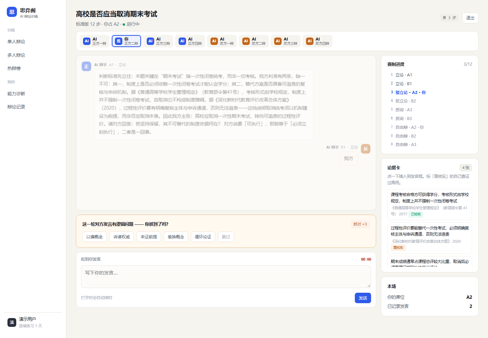

# Lyceum · 思弈阁

AI 4v4 辩论训练系统：8 个 AI 辩手各占一席、各有打法，你坐其中一个位置，和整支队伍打完整场。

**在线试用：<http://120.24.204.138:8787/siyige/>**



## 现在能做什么

- **12 步赛制**：立论 → 驳立论 → 质询 → 自由辩 → 总结
- **8 席 AI 辩手**：框架派 / 快攻派 / 例证派 / 归谬派 / 定义派 / 反例派 / 归因派 / 价值派
- **自由选位**：挑任意一席，其余 7 席 AI 补位
- **自拟辩题**：AI 先审可辩性，不合格给修改建议
- **自由辩抢拍**：8 秒窗口，抢到才有话筒
- **抓漏**：每轮埋一个逻辑漏洞，从 5 类里指认，答对 +3
- **作战卡**：赛前给定义、立论骨架、对方打法、回应句式
- **复盘**：五维评分（立论 25 / 论证 30 / 表达 15 / 应变 20 / 论据 10）+ 逐回合点评
- **论据卡**：48 张（12 辩题 × 4），标「需核实」，编数字倒扣
- **热辩榜 / 能力分析 / 辩论记录**：Redis ZSET 排行，五维雷达，只记录不排名
- **多人房间**：8 席，房间号拉人，缺位 AI 补
- **讨论社区**：闲聊 / 教程 / 求助三类帖子、两层楼中楼、点赞、浏览计数、敏感词自动打码
- **账号登录**：注册 / 登录 / 登出；发帖评论点赞需登录，浏览不用；未登录不计浏览数
- **登录后开打**：辩论、房间、战绩、诊断统一要登录；对局只有本人（或同房间的人）能看能操作
- **社区治理**：帖子 / 评论可举报，管理员在 `/admin` 后台处置（删内容 / 禁言 1·3·7 天 / 全站封禁），处置可撤销
- **账号安全**：用户与管理员均可改密码，改后旧登录立即失效；管理员处置留痕，可一键恢复被删内容
- **通知与 @**：评论 / 回复 / 点赞 / @ / 被删 / 被处罚都会提醒，点赞按内容聚合成一条；侧栏红点显示未读数
- **社区 @AI**：`@DeepSeek` 像普通用户一样回帖（带回帖层级和「AI」标签），每账号每天 5 次
- **好友与私聊**：搜人加好友（可附言）→ 双向确认；只有好友能私聊，消息走 WebSocket 实时到达，断线按 id 补拉、连不上自动降级 3 秒轮询
- **邀请组队**：房主在房间页点「邀请好友」，对方在聊天窗收到卡片，点一下直接进房
- **手机端**：底部导航、输入框吸底

## 跑起来

```bash
cd server
cp config/application.example.yml config/application.yml   # 填 api-key（不填走模板回复）
mvn spring-boot:run                                        # 打开 http://localhost:8080
```

需要本地 Redis（社区浏览计数与去重用，必需）：

```bash
docker run -d --name siyige-redis -p 6379:6379 redis:7-alpine --requirepass siyige123456
```

## 技术栈

Java 17 · Spring Boot 3.3 · SSE + WebSocket · H2/Redis · 原生 JS（无框架无构建） · DeepSeek

密码 Argon2id 哈希 · 会话 JWT（HS256，2 小时）

## 目录

```
server/src/main/java/com/siyige/   api / service / ai / domain / engine / repo / community / auth / admin / social
server/src/main/resources/static/  index.html + admin.html + css + js/views/*（一人一块）
docs/                              SPEC 规格 / AI 方案 / 协作规范 / 项目进度 / 接口契约
```

## 更新记录

> 每次开发完在下面加一段，新的放最上面。一行说清「改了什么 / 为什么」。

### 2026-11-09

**赛制**
- **质询 / 自由辩改多轮**：质询 2–4 轮/方（问 → 答交替），自由辩 3–6 轮，轮数**每场随机**；一场从 12 步变成 20–27 步，接近真实赛制

**计费**
- **钱包与充值**：余额按「分」存整数；一场费用 = 模型成本（按 token 实算）+ 服务费（0.30 元/场）；开局**预扣**、结束**多退少补**；余额不足不给开局
- 新用户自动送 1 元体验金；侧栏显示余额胶囊，复盘页显示本场账单
- **按对局精确计量 token**：模型调用按对局打标归集（不再用全局差值），并发时不会把 A 的消耗算到 B 头上

**支付**
- **充值走真实支付流程**：下单（不入账）→ 模拟收银台 → 回调**验签**（HMAC-SHA256）→ **幂等入账** → 订单查询；金额篡改与重放都挡住

**自定义模型**
- **用户自带 API（BYOK）**：可填自己的 baseUrl / model / key 跑对局，模型成本记 0、只收 0.30 元/场服务费；key 读回只回掩码，带连通性测试

### 2026-11-07
- **好友与私聊**：搜人加好友（双向互发直接成为好友）、只有好友能聊、未读角标与通知分开；WebSocket 实时（心跳 + 断线重连补拉），连不上自动降级 3 秒轮询
- **邀请组队**：房主在房间页邀请好友，对方在聊天窗点卡片一键进房

### 2026-11-05
- **社区 @AI**：帖子或评论里 `@DeepSeek`，它像普通用户一样回帖（发帖回一条楼、楼里回楼中楼，昵称旁带「AI」标签），异步排队、每账号每天 5 次
- **通知与 @提及**：11 类通知（评论 / 回复 / 点赞 / @ / 被删 / 被处罚），点赞按内容聚合成一条，侧栏红点显示未读数
- **AI 评审团**：4 位裁判（结构 / 交锋 / 表达 / 论据）并行独立打分后取平均，按「问题类型」聚合出「多位裁判都提到的问题」，一次约 6 秒
- **评分按席位分开**：占多个位置时，每个席位单独算分（原来合并成一段，看不出二辩打得怎么样）
- **敷衍发言处理**：回「11」「嗯」这类内容标记为无效发言，不计分；AI 不再引述它，改为直接点出「你这一轮没有回答问题」
- 修复 AI 把队友的话标成「对方说」
- 本地演示节奏从 1/33 放慢到 0.3（真实时长设 1.0，一场约 30 分钟）

### 2026-11-04
- 辩论侧接入账号：未登录不能玩；对局只有本人或同房间席位能看能操作；SSE 令牌走 `?token=`
- 房间席位显示账号昵称，「房主 / 玩家」改成小标签；登录后回到来路页面
- **新增「视频」模块**：辩论短视频广场，竖屏全屏滑动、按环节（立论/驳立论/质询/自由辩/总结/名场面）筛选、点赞评论，导航里与社区平级独立成组
- **视频电子审核**：机器初审三级判定（结构校验 → 违禁词驳回 → 风险词转人工），未过审不进广场；每次判定写入 `sy_video_audit`，人工复核台留到管理端接入后再开
- **AI 发言模板扩容**：兜底句式 2→10 条/环节、承接对方的话术 1→8 种、环节结构 3 套变体随机，并记忆本场用过的开头

### 2026-11-03
- 社区治理上线：举报 + 独立管理员后台 `/admin`（社区禁言 / 全站封禁）+ 处理记录与一键恢复
- 账号安全：双端改密码，改后旧登录立即失效（401 `TOKEN_STALE`）
- 修复「打字打到一半被判超时、发言丢失」：单人模式下 keepalive 不再制造截止时间；提交失败时输入内容保留
- 新增 /api/usage 模型用量统计（一场完整对局约 8,700 token）
- 新增账号系统：注册 / 登录 / 登出，密码 Argon2id、会话 JWT 2 小时
- 社区改为登录制：发帖评论点赞要登录、浏览不用，未登录的浏览不计入浏览数
- 账号入口收进侧栏左下角，手机端底栏保留入口
- 前端拆成 8 个模块文件，支持两人并行开发
- 新增项目进度页与对外版 README

### 2026-11-02
- 讨论社区并入 SPA：独立页收成跳转壳，前端抽为 `js/views/community.js`
- 社区后端按 SPEC v4.2 §18 重建：14 个接口、三表 + 11 索引、两层楼中楼、热度与浏览计数
- 修复「上一个人没说完下一个人就说话」：打字改串行，排队气泡不再提前上屏
- 打字逐字输出，句号停顿，整段约 11 秒
- AI 回应改为 10–15 秒间隔；开场第一句不等
- 单人模式不限时，多人每步上限 10 分钟；新增「催一下」
- 手机端适配

### 2026-11-01
- 部署上线；抢拍、抓漏、作战卡上线

## 更多

- 产品规格：[docs/SPEC.md](docs/SPEC.md)
- AI 设计：[docs/AI-方案.md](docs/AI-方案.md)
- 进度与分工：[docs/项目进度.md](docs/项目进度.md)
- 协作规范：[docs/协作规范.md](docs/协作规范.md)
- 管理接口契约：[docs/管理接口契约.md](docs/管理接口契约.md)
- 社区接口契约：[docs/社区接口契约.md](docs/社区接口契约.md)
- 社交接口契约（好友 / 私聊 / 邀请）：[docs/社交接口契约.md](docs/社交接口契约.md)
- 认证接口契约：[docs/认证接口契约.md](docs/认证接口契约.md)
- 辩论接口鉴权：[docs/辩论接口鉴权契约.md](docs/辩论接口鉴权契约.md)

MIT License
